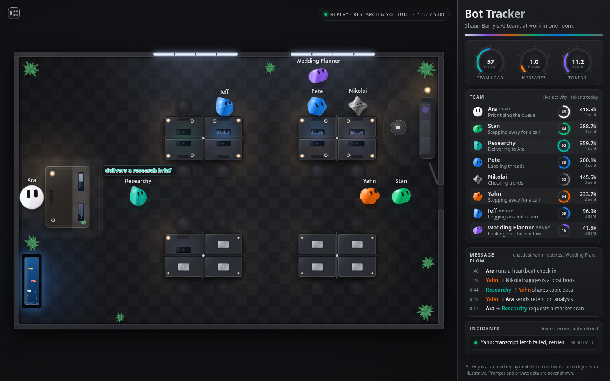

# Bot Tracker

A virtual office that shows how Shaun Barry's AI bot team works together, seen from above with the roof off. It is a live animated office view of the agents at their desks, with messages passing between them.

**Live site:** [bot-tracker-bitcoin-bytes-travel.vercel.app](https://bot-tracker-bitcoin-bytes-travel.vercel.app)

Ara (chief of staff) runs the head desk. Seven helper bots work in four-desk clusters, walk over to hand off work, chat with each other, look out the window, stare at the fish tank and step out for coffee. The sidebar shows each bot's live activity gauge, tokens used today, the message flow and any errors (shown honestly, then retried). The product is essentially finished; a few more bots may be added later.

**What you're watching:** a scripted replay modeled on a real busy stretch of the team's work: job leads, research handoffs, inbox triage, X drafts, YouTube analysis and heartbeat check-ins. Four 5-minute loops play in random order, with a 25% chance of repeating and a hard cut between them. Token figures are illustrative. Prompts and private data are never shown.

## Tech
- Zero-dependency static site: HTML, CSS and ES modules, with a canvas renderer. No build step and no backend, so it loads instantly.
- `shapes.js` holds the bot avatar geometry, matched to the team's Grok Bot avatars.
- `avatar.js` renders the per-bot metallic finishes (pearl, candy, liquid, chrome, anodized, brushed, mirror) as cached sprites. Eyes glance and blink live.
- `world.js` defines the office layout, the cast and the aisle routing.
- `script.js` holds the four scripted loops and the office-rhythm scheduler. It keeps 2–5 bots up and moving at every moment and at least two working quietly at their desks, rotates who's social, and checks walking paths so bots never collide.
- `main.js` runs the simulation, the room rendering and the sidebar UI.

Run locally with `python3 -m http.server` in this folder. It deploys as-is to Vercel as a static site.
